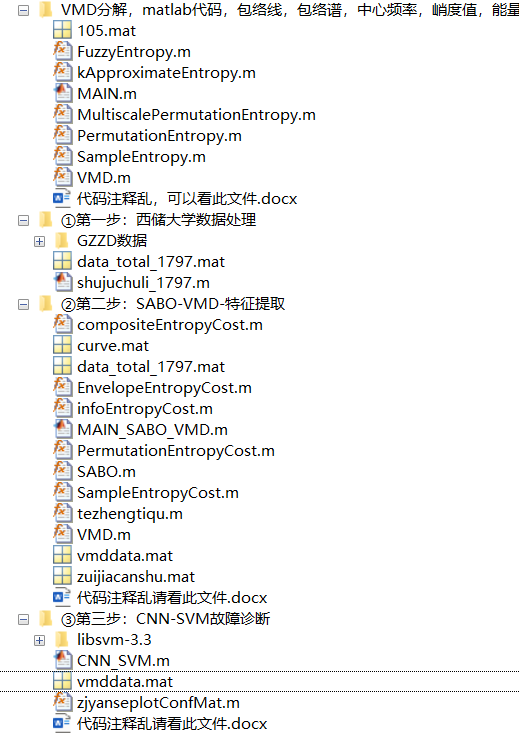
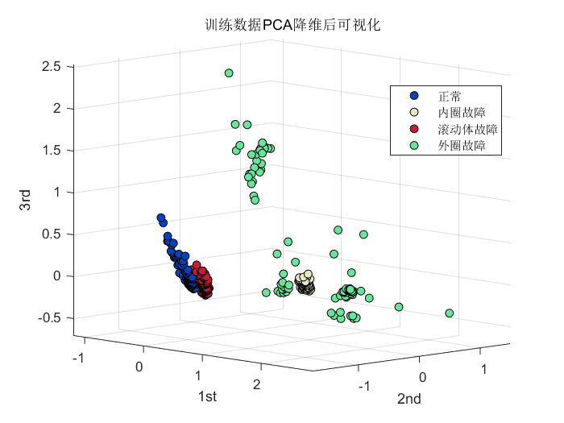
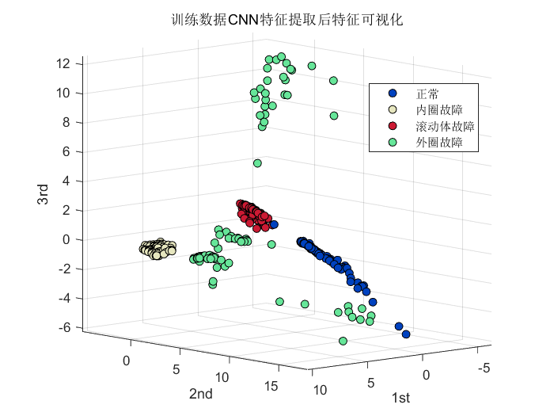
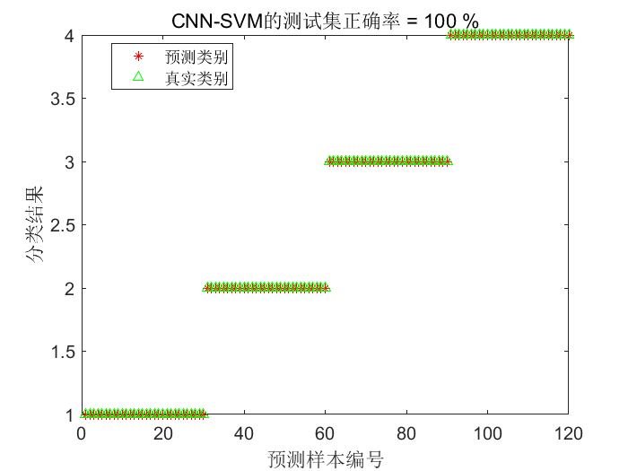
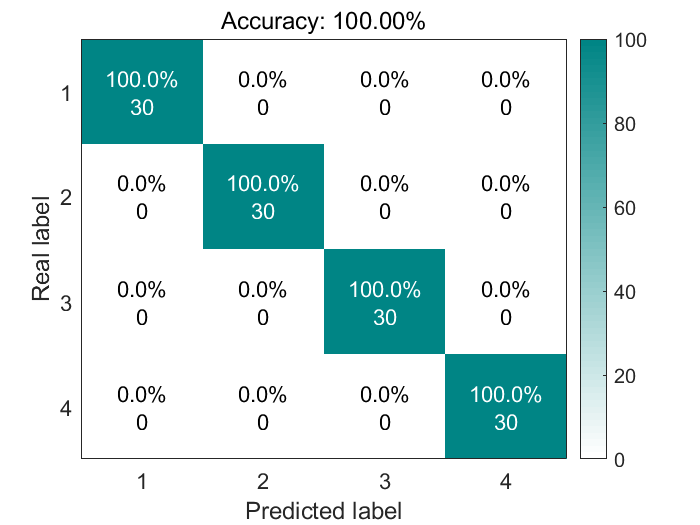
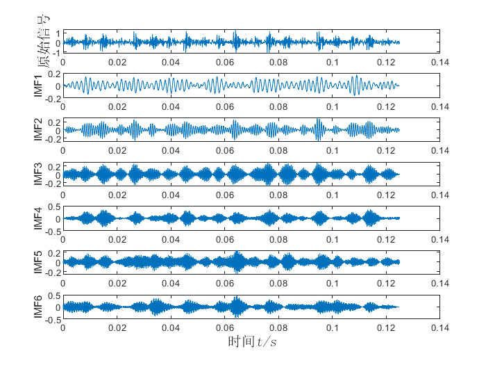
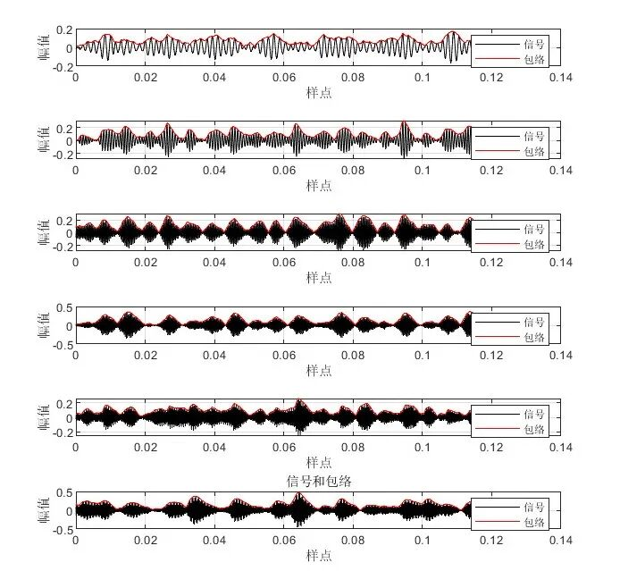
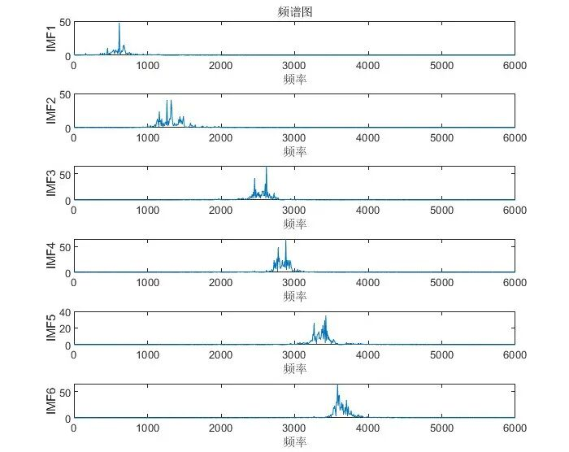
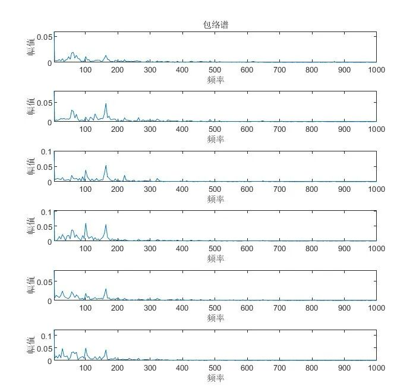

# Comprehensive Tutorial: SABO-VMD-CNN-SVM Classification Diagnosis, Feature Visualization

Today, we will release a classification diagnosis based on SABO-VMD-CNN-SVM. 

The classic Western Reserve University bearing data will be used again. The basic process is as follows: 
Firstly, the minimum entropic envelope is used as the fitness function, and SABO optimizes the two parameters of VMD. Secondly, the feature vectors are obtained for each state's data, and labels are assigned to each set of data. Then, the data is fed into CNN for feature extraction, followed by PCA dimensionality reduction and visualization of features. The results of visualizing features without CNN feature extraction are compared with those. Finally, the CNN extracted features are sent to SVM for classification. 
This method can be applied to other data fault classification! Data replacement is very simple, and the code comments are very detailed! 
The folder directory is as follows: all carefully organized by the author. The program runs very simply, following the steps step by step! 
As shown in the screenshot, this issue contains three main tasks: 
1. Processing the official downloaded Western Reserve University data 
Steps include: 
①Load four types of data, namely normal state, inner ring fault, outer ring fault, rolling element fault. ②Set the sliding window w, the number of sample points s for each data fault sample, and the sample quantity m for each fault type. ③After all the data sliding windows are completed, integrate them into one variable, which is the data_total_1797.mat shown in the screenshot. 
Previous articles have also discussed the processing of Western Reserve University bearing diagnostic data, you can refer to this article: Western Reserve University Bearing Diagnosis Data Processing, MATLAB Free Code Acquired. 
2. Feature extraction from the first step's processed data 
The specific principle of feature extraction is also elaborated in this article, you can jump to read. In short, it is to extract the optimal IMF component of each sample with the smallest entropic envelope criterion, then calculate nine indicators for each sample: mean, variance, peak, kurtosis, effective value, peak factor, pulse factor, waveform factor, and margin factor. Then construct the feature vector for each sample using these nine indicators.
Additionally, this article employs the 2023 more recent and efficient intelligent algorithm - Subtraction Optimizer (SABO) to optimize the VMD parameters. It finds the optimal IMF components for each fault type and utilizes the criterion of minimum enclosing entropy to extract the best IMF components.
Thirdly, Convolutional Neural Networks (CNN) are used to extract data features.
Here is a comparative experiment. The visualization results of vectors after CNN feature extraction compared with those without CNN feature extraction. The specific method is PCA dimensionality reduction followed by visualization. The results are as follows:
The first image shows the result of directly using PCA dimensionality reduction without CNN feature extraction, which reveals severe overlap between normal state and rolling element fault! However, after CNN feature extraction in the second image, there is no overlap among the four states, and the distinction between each category is clear! This proves the effectiveness of CNN feature extraction.
Fifth, Support Vector Machines are used for fault classification.
This article adopts a grid search mechanism and uses 5-fold cross-validation to optimize the penalty factor c and gamma parameters of SVM.
Results are shown in a confusion matrix graph, which some articles may use:
It must be said that the accuracy of the official libSVM package is very high!
All the above images can be reproduced in the code package.
Some students may use frequency spectrum graphs, envelope spectrum graphs, etc. Here we take the fault signal "105.mat" as an example to demonstrate:
After running the MAIN.m file under the folder "VMD decomposition, matlab code, envelope line, envelope entropy...", the following run results will appear in the command window:
The calculation results will appear as follows:
IMF1The kurtosis value is: 2.6102\nIMF2The kurtosis value is: 3.3346\nIMF3The kurtosis value is: 2.9038\nIMF4The kurtosis value is: 3.5663\nIMF5The kurtosis value is: 2.7648\nIMF6The kurtosis value is: 3.2977\nIMFEnergy of the component\n    4.9829   10.5892   14.4765   19.8061    8.4764   24.3339\n\nEMDEnergy entropy=%.4f\n    0.1693    0.2632    0.3051    0.3423    0.2335    0.3600\n\nIMF1The approximate entropy is: 0.023426\nIMF2The approximate entropy is: 0.15115\nIMF3The approximate entropy is: 0.08722\nIMF4The approximate entropy is: 0.04402\nIMF5The approximate entropy is: 0.052554\nIMF6The approximate entropy is: 0.14538\nIMF1The envelop entropy is: 7.2053\nIMF2The envelop entropy is: 7.14\nIMF3The envelop entropy is: 7.1537\nIMF4The envelop entropy is: 7.0853\nIMF5The envelop entropy is: 7.2063\nIMF6The entropies of the envelopes are: 7.1476\nLocal minimum envelope entropy is: 7.0853\nIMF1The entropy of the fuzzy set is: 0.12759\nIMF2The entropy of the fuzzy set is: 0.090684\nIMF3The entropy of the fuzzy set is: 0.041706\nIMF4The entropy of the fuzzy set is: -0.0032906\nIMF5The entropy of the fuzzy set is: -0.011035\nIMF6The entropy of the fuzzy set is: 0.030635\nIMF1The arrangement entropy is: 0.61446\nIMF2The arrangement entropy is: 0.76756\nIMF3The arrangement entropy is: 0.93485\nIMF4The arrangement entropy is: 0.95524\nIMF5The arrangement entropy is: 0.98658\nIMF6The arrangement entropy is: 0.99433\nMulti-scale arrangement entropy: \n0.36792     0.50757     0.56639     0.64017     0.68493     0.66705     0.69098     0.66583     0.61102     0.62604     0.62396     0.61879     0.67588     0.66087     0.67663     0.65568     0.66656     0.65949     0.63769     0.63972     0.63041     0.60632     0.60124     0.58355     0.57844      0.5803     0.57774     0.55767     0.51696     0.55986\n0.48773     0.66594     0.69663     0.62542     0.59005     0.72211     0.73193     0.69654      0.6619      0.6861     0.71204     0.67167     0.63684     0.64251     0.64805     0.65568     0.63513     0.65138     0.64346     0.62353     0.62084     0.58707     0.57752     0.59973     0.58993     0.55851     0.57774     0.58401     0.57735      0.5739\n0.57786     0.57523     0.67386     0.65101     0.56296     0.71078     0.58023     0.71316     0.67834     0.65725     0.68971     0.64193     0.68882     0.67817     0.65194     0.64461      0.6221     0.64496     0.62037     0.62467     0.60686     0.59167     0.60124     0.59603     0.58993      0.5803     0.58617     0.58401     0.55902     0.56922\n0.58138     0.47632     0.65939     0.66591     0.64333     0.65131     0.68434     0.63124     0.61944     0.67578     0.65511     0.67651     0.64736     0.66422     0.61521      0.6437     0.61607     0.63518     0.60773     0.63671     0.60246     0.58959     0.61178     0.56737     0.59376     0.58841     0.55667     0.55162     0.57277     0.57859\n0.54329     0.53176       0.618     0.59543     0.66657     0.71203     0.68693     0.69594     0.56685     0.71009     0.64683     0.66333     0.67515     0.67042     0.63474     0.59895     0.66148     0.64328     0.62614      0.6337     0.63041     0.61969     0.59859     0.58864     0.59376     0.56662     0.57774     0.58401     0.57735     0.56922\n0.53646     0.58339      0.5363     0.66055     0.50474     0.62548     0.65051     0.63196     0.67276      0.6993     0.67454     0.64403     0.61372     0.67611      0.5754      0.6362     0.64941     0.59124     0.63191     0.60547     0.60168     0.60632     0.61178     0.60343     0.53724     0.57877     0.59039     0.57523     0.54182     0.56922\nIMF1The sample entropy is: 0.6129\nIMF2The sample entropy is: 0.52726\nIMF3The sample entropy is: 0.32156\nIMF4The sample entropy is: 0.21892\nIMF5The sample entropy is: 0.30553\nIMF6The sample entropy is: 0.24375\nPartial code  
Data Processing Code:
clc;\nclear;\naddpath(genpath(pwd));\n%DE is the data from the driver side, FE is the fan side data, and BA is the acceleration data. Choose one of them.\nload 97.mat  %Normal\nload 105.mat  % Diameter 0.007 inches, inner ring failure at 1797 RPM\nload 118.mat   % Diameter 0.007, Rolling Bear Fault at Rotational Speed 1797\nload 130.mat  % Diameter 0.007, outer ring failure at speed 1797\n% There are 4 states, each state has 120 samples, and the data size of each sample is: 1×2048\nw=1000;                  % w is the size of the sliding window, 1000\ns=2048;                  % Each fault represents 2048 fault points\nm = 120;            % Each type of fault has 120 samples\nD0=[];\nfor i =1:m\n    D0 = [D0,X097_DE_time(1+w*(i-1):w*(i-1)+s)];\nend\nD0 = D0';\nD1=[];\nfor i =1:m\n    D1 = [D1,X105_DE_time(1+w*(i-1):w*(i-1)+s)];\nend\nD1 = D1';\nSABOOptimizationVMDCode for parameter and feature extraction:   
%% Optimize VMD using SABO algorithm to minimize entropies of minimum enclosing, minimum sample, minimum information, minimum arrangement, and arrange entropy/mutual information entropy, as the objective function (choose one).\nclear\nclc\nclose all\naddpath(genpath(pwd))\nxz = 1;  %xz, select 1, using minimum entropic fitness as the fitness function.\n% Select 2, using the minimum sample entropy as the fitness function.\n% Select 3, using the minimum information entropy as the fitness function.\n% Select 4, using the minimum arrangement entropy as the fitness function.\n% Select 5, using the compound indicator: Arrangement Entropy/Mutual Information Entropy as the fitness function.\nif xz == 1  \n    fobj=@EnvelopeEntropyCost;          % Minimum Entropy\nelseif xz == 2\n    fobj=@SampleEntropyCost;            % Minimum sample entropy\nelseif xz == 3  \n    fobj=@infoEntropyCost;              % Minimum Entropy\nelseif xz == 4\n    fobj=@PermutationEntropyCost;       % Minimum Arrangement Entropy\nelseif xz == 5\n    fobj=@compositeEntropyCost;       %Composite Index: Arrangement Entropy / Mutual Information Entropy\nend\nload data_total_1797.mat   % Here, we select 4 types of faults with a rotational speed of 1797. You can also choose other types of data.\nD=2;             % Optimize the number of variables\nlb=[100 3];      % Lower limit, which are a, k\nub=[2500 10];        % Upper limit value\nT=20;       % Maximum number of iterations\nN=20;        % Population size\nvmddata = [];% Save the extracted fault feature vector\nzuijiacanshu = []; %Save the best VMD parameters for each fault state and corresponding optimal IMF index values.\ncurve = [];  %Save the optimization VMD convergence curve corresponding to each fault state.\nfor i=1:4   % There are 4 types of fault states\n    disp(['Currently,',num2str(i),'Data for a variety of fault typesVMDOptimization……Please wait patiently.! '])\n    every_data = data(1+120*(i-1):120*i,:);  % A state is 120 samples, each time select 120 samples for VMD optimization and feature extraction.\n    vmddata =  [vmddata;new_data];  % Collect all the feature vectors extracted from each state together\nend\n    save curve curve  %Save the optimization VMD convergence curve corresponding to each fault state\n    save zuijiacanshu zuijiacanshu  %Save the best VMD parameters for each fault state and corresponding optimal IMF index values.\n    save vmddata.mat vmddata  % Save the extracted feature vectors as mat files\nCNN-SVMDiagnostic code:   
%% Initialization\nclear\nclose all\nclc\nwarning off\n% Data Reading\naddpath(genpath(pwd));\nload vmddata.mat  % Load the preprocessed feature data\ndata = vmddata;\nbv = 120;    % Each state data has 120 groups\n%% Adding label values to data\nhhh = size(data,2);\nfor i=1:size(data,1)/bv\n    data(1+bv*(i-1):bv*i,hhh+1)=i;\nend\ninput=data(:,1:hhh);\noutput =data(:,end);\n\n%% Splitting the training set and test set\njg = bv;   % 120 samples per group\ntn = 90;    % Each group of data selects the first tn samples for training, and the remaining bv-tn samples for testing.\ninput_train = []; output_train = [];\ninput_test = []; output_test = [];\nfor i = 1:max(data(:,end))\n    input_train=[input_train;input(1+jg*(i-1):jg*(i-1)+tn,:)];\n    output_train=[output_train;output(1+jg*(i-1):jg*(i-1)+tn,:)];\n    input_test=[input_test;input(jg*(i-1)+tn+1:i*jg,:)];\n    output_test=[output_test;output(jg*(i-1)+tn+1:i*jg,:)];\nend\ninput_train = input_train'; \ninput_test = input_test';\n% Normalization processing\n[inputn_train,inputps]=mapminmax(input_train);\n[inputn_test,inputtestps]=mapminmax('apply',input_test,inputps);  inputn_test =inputn_test';\n[c,g] = meshgrid(-10:0.5:10,-10:0.5:10);  % Adjust the spacing to search more precisely\n[m,n] = size(c);\ncg = zeros(m,n);\neps = 10^(-4);\nv = 5;  % 5-fold cross-validation is adopted.\nbestacc = 0;\n  
Code Acquisition
Link: Copy the link and open it in your browser.
Or click below to read the original text.
Or reply with the keyword "CNNSVM" in the backend for more excellent articles on fault diagnosis.
For more recommendations, click here.

Pediatric Tutorials - VMD-CNN-BILSTM Bearing Fault Diagnosis, MATLAB Code
Pediatric Tutorials - ICEEMDAN-GWO-LSSVM Bearing Diagnosis, MATLAB Code
Pediatric Tutorials - SABO-VMD-SVM Xiu'er University Bearing Diagnosis
Pediatric Tutorials - VMD-SABO-KELM Optimized Kernel Extreme Learning Machine Xiu'er University Bearing Diagnosis
Perfect Reproduction of "Three Highs" Paper! Fan Bearing Weak Fault Diagnosis Based on PSO-VMD-MCKD Method, Early Weak Fault Diagnosis, MATLAB Code Implementation
Perfect Reproduction of "Three Highs" Paper! Bearing Fault Diagnosis Method Based on EEMD Singular Value Entropy, MATLAB Code Implementation
VMD Decomposition, MATLAB Code, Envelope Line, Spectrum, Center Frequency, Kurtosis, Energy Entropy, Sample Entropy, Fuzzy Entropy, Arrangement Entropy, Multiscale Arrangement Entropy, Xiu'er University Dataset Example

## Images

<!-- PAYMENT_BLOCK -->

## Get this dataset

- Payment link (Stripe): [Buy now](https://buy.stripe.com/3cs8yP7sY87d0vu9AB)
- Payment QR code: 

<!-- /PAYMENT_BLOCK -->
